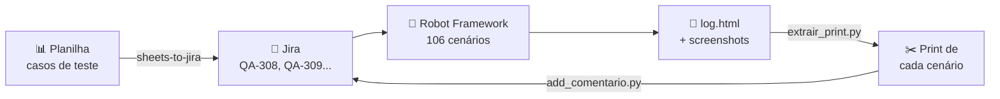

# 🤖 Automação E2E com Robot Framework + evidências automáticas no Jira


Automação de testes de front-end de um sistema de **solicitação de laudos de vistoria veicular**, com **106 cenários em BDD**, Page Objects e uma integração em Python que **publica as evidências de cada cenário direto no card do Jira**: print do relatório, screenshot da tela, nota de aprovado ou reprovado e mudança de status no workflow.

> **Sobre este projeto.** Esta é a versão para portfólio de uma automação que desenvolvi como QA. O sistema testado foi renomeado para **VeriCar** (marca fictícia), e URLs, usuários, senhas, placas, IDs do Jira e imagens foram substituídos por dados de exemplo. A estrutura, as keywords e a lógica são as da entrega original. Como o sistema testado é privado, os testes servem como **código de referência**: a validação estrutural (dry-run) e os testes unitários rodam em qualquer máquina.

## O fluxo completo



1. Os casos de teste nascem no Jira a partir de uma planilha ([sheets-to-jira-test-cases](https://github.com/ramosth/sheets-to-jira-test-cases)).
2. Cada cenário Robot leva o ID do card no nome: `Cenário: QA-308 (FRONT) Abrir modal...`.
3. Após a execução, **`extrair_print.py`** abre o `log.html` em um Chrome headless e recorta o bloco de cada cenário, separando-os em `sucessos/` e `falhas/`.
4. **`add_comentario.py`** localiza, pelo ID, o screenshot **mais recente** da tela (salvo pelo teardown), anexa as duas imagens no card e publica um comentário:

   | Resultado | Comentário no Jira | Transição |
   |---|---|---|
   | ✅ Passou | painel verde **TESTE AUTOMAÇÃO APROVADO** + imagens | `Automation` → `Ending` |
   | ❌ Falhou | painel vermelho **TESTE AUTOMAÇÃO REPROVADO** + imagens | `Automation` → `Blocked` |

5. Ao final, um relatório no terminal mostra totais, taxa de sucesso, anexos, transições e erros.

**Resultado:** junto com a criação dos casos em massa, o tempo gasto com cadastro e evidências caiu **75% (de 16 para 4 horas)**, com rastreabilidade completa: cada card de teste guarda a prova da última execução.

## O que os testes cobrem

Feature **VC-16 · Nova Análise**: o fluxo de solicitação de laudo em um modal de 4 etapas.

| Etapa | Exemplos de validações |
|---|---|
| **1. Dados** | 13 campos, obrigatórios × opcionais, mensagens de erro por campo, CPF/CNPJ válidos e inválidos (inclusive **CNPJ alfanumérico**), limites de caracteres, campos numéricos |
| **2. Itens** | 17 itens de segurança, 6 condições do veículo com observações, pular etapa e persistência ao voltar |
| **3. Anexos** | Upload de PNG/JPEG, limite de 6 imagens e de tamanho, formato não suportado, miniaturas, exclusão e resoluções aceitas |
| **4. Resumo** | Seções exibidas ou ocultas conforme os dados, exclusão de imagem pelo resumo, indicadores de progresso |
| **Emissão** | Modal de sucesso e de erro, nova tentativa, novo ID de 17 dígitos no topo da lista, responsável e data |
| **Laudo em PDF** | Download, seções na ordem, dados da solicitação no PDF, carimbo de data e hora, bases consultadas no rodapé de todas as páginas, débitos e restrições (Multas, IPVA, DPVAT, Licenciamento, RENAJUD, Gravame, Roubo e Bloqueio) |

## Arquitetura

O projeto separa **o que** é testado (features em Gherkin) de **como** a tela é manipulada (Page Objects, keywords e locators). Cada teste importa um único arquivo, o `config/package.robot`.

```
.
├── config/
│   ├── package.robot          # ponto único de imports (bibliotecas, dados, locators, pages, keywords)
│   └── hooks.robot            # setup/teardown: navegador, evidências, downloads, criação de laudos
├── libraries/
│   ├── CPFGenerator.py        # CPF válido/inválido para testes
│   ├── CNPJGenerator.py       # CNPJ numérico
│   ├── CNPJAlfanumericoGenerator.py   # novo CNPJ alfanumérico (Receita Federal, 2026)
│   ├── LaudoPDF.py            # leitura e validação do laudo em PDF (pypdf)
│   └── integracao_jira/
│       ├── extrair_print.py   # ETAPA 1: recorta cada cenário do log.html
│       └── add_comentario.py  # ETAPA 2: anexa, comenta e move o card no Jira
├── resources/
│   ├── data/                  # massa de dados e textos esperados (YAML)
│   ├── locators/              # seletores (XPath) por tela
│   ├── keywords/              # ações reutilizáveis por componente (modal, tabela, paginação...)
│   └── pages/                 # passos Gherkin por tela (Page Objects)
└── tests/
    ├── features/VC-16_NovaAnalise.robot   # 106 cenários
    ├── fixtures/uploads/      # imagens SINTÉTICAS para os testes de upload
    └── unit/                  # pytest das bibliotecas Python (sem rede)
```

**Padrões adotados**
- **BDD em português**: `Dado / Quando / Então / E`, com um ID do Jira por cenário
- **Page Object em camadas**: feature → page (Gherkin) → keyword (ação) → locator
- **Massa de dados dinâmica**: documentos válidos gerados a cada execução e dados variáveis em YAML
- **Evidência padronizada no teardown**: `results/screenshots/screenshots DD-MM-AAAA/<feature>/<ID> <título> [ SUCESSO|FALHA ] HH_MM_SS.png`
- **Tags**: `smoke`, `sanity` e `regression` para montar suítes

## Como executar

```bash
python -m venv .venv
.venv\Scripts\activate          # Windows
# source .venv/bin/activate     # Linux/macOS
pip install -r requirements.txt
```

**Validação estrutural (roda em qualquer máquina):** confere que todos os passos, keywords e variáveis existem, sem abrir o navegador.

```bash
robot --dryrun --output NONE tests/features
pytest tests/unit -v
```

**Execução real** (exige acesso ao ambiente do sistema e usuários em `resources/data/login_data.yaml`):

```bash
robot tests/features                                  # suíte completa
robot --include smoke tests/features                  # só os smoke
robot --exclude manual tests/features/VC-16_NovaAnalise.robot
```

## Publicando as evidências no Jira

```bash
cp .env.example .env    # preencha URL, e-mail, token e nomes das transições

python libraries/integracao_jira/extrair_print.py     # 1. recorta os cenários do log.html
python libraries/integracao_jira/add_comentario.py    # 2. anexa, comenta e move os cards
```

Saída de exemplo:

```
[INFO] 📌 Processando: QA-308
[ANEXO] 📎 QA-308: QA-308.png
[ANEXO] 📎 QA-308: QA-308 (FRONT) Abrir modal ... [ SUCESSO ] 15_42_11.png
[COMENTÁRIO] 🖼️ QA-308: publicado com 2 imagem(ns)
[TRANSIÇÃO] ✅ QA-308 → Ending
...
📊 RELATÓRIO FINAL DE PROCESSAMENTO
   📋 Cards processados: 106
   ✅ Aprovados: 101  |  ❌ Reprovados: 5
   📈 Taxa de sucesso: 95.3%
```

## Qualidade do próprio código de teste

- **CI no GitHub Actions**: a cada push roda o dry-run dos 106 cenários e os testes unitários
- **Testes unitários** (pytest) das regras críticas: falha tem prioridade sobre sucesso, screenshot mais recente, decisão de transição e validação do PDF com um laudo fictício gerado na hora
- **Credenciais fora do código**: `.env` e senhas não são versionados

## O que mudou na versão de portfólio

Para publicar, além de anonimizar os dados, eu completei o que o recorte original não trazia. Assim a feature fica íntegra (dry-run com 106 de 106 cenários resolvidos):

- **Correção:** o `package.robot` importava `solicitacao_page.robot`, que não existia; o Page Object correto é `nova_analise_page.robot`
- **Completado:** os passos da tela de Listagem e do laudo em PDF ficavam em outro módulo do projeto e foram reescritos em `listagem_page.robot`, `laudo_pdf_page.robot`, `listagem_locators.robot`, `listagem_laudo.yaml` e `LaudoPDF.py`, reaproveitando as keywords de baixo nível existentes
- **Refatoração:** os scripts de integração com o Jira ganharam funções menores, configuração via `.env` (status e transições) e testes
- **Limpeza:** bibliotecas importadas e não usadas foram removidas, e as imagens de teste foram trocadas por imagens sintéticas

## Projeto relacionado

📋 [**sheets-to-jira-test-cases**](https://github.com/ramosth/sheets-to-jira-test-cases): cria os casos de teste no Jira em massa a partir do Google Sheets, ponto de partida deste fluxo.

---

Desenvolvido por [Thamires Ramos](https://github.com/ramosth) · [LinkedIn](https://linkedin.com/in/thamires-ramos/)
